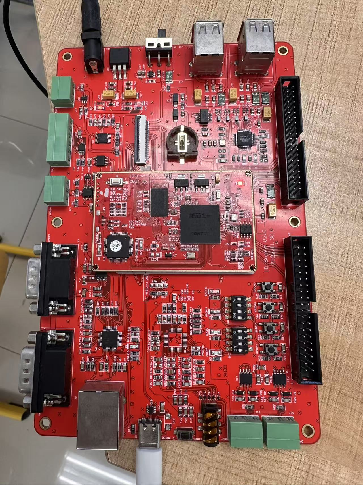
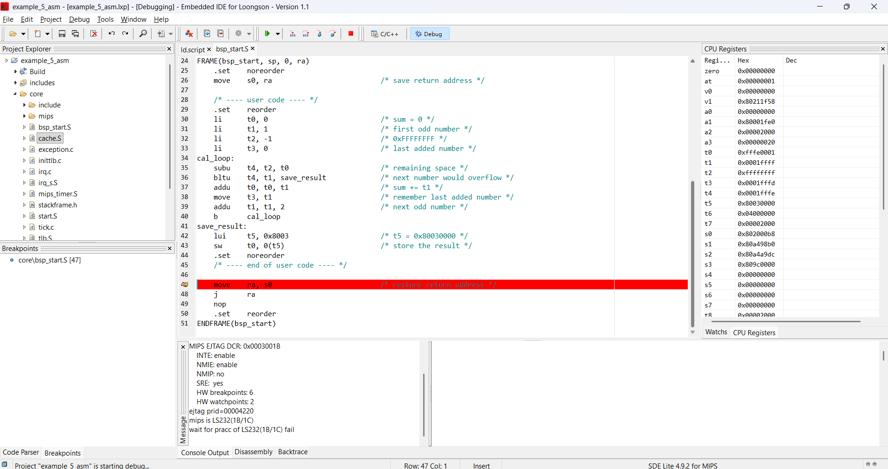
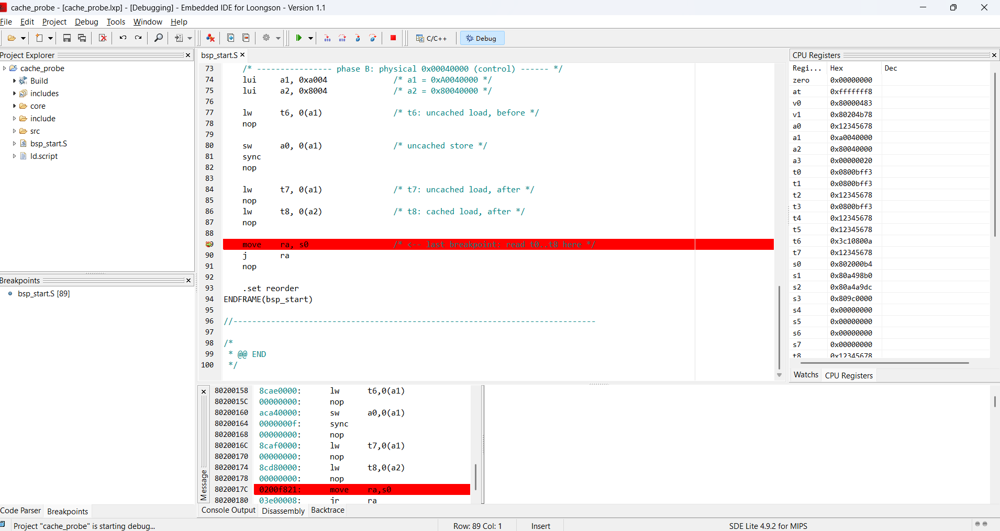
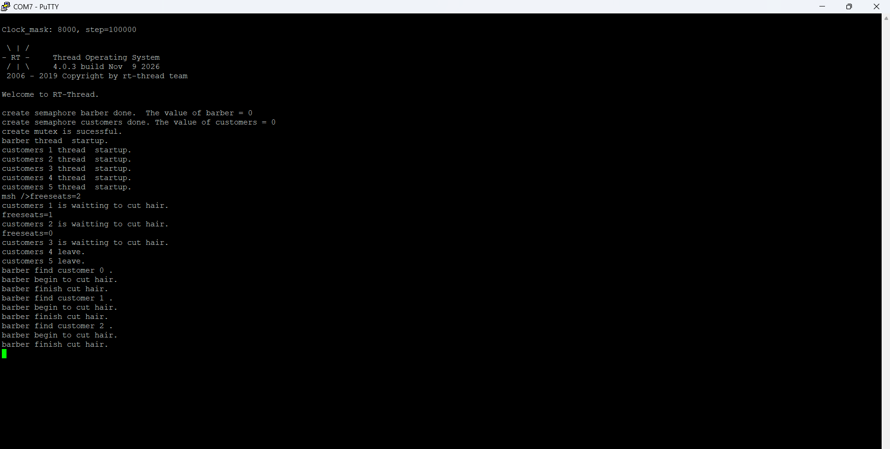
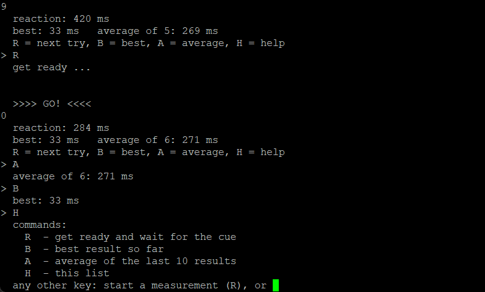

# Loongson 1B — Computer System Comprehensive Design (2026)

Course work on a **Loongson 1B (LS1B200 / MIPS32 R2)** development board: hand-written
assembly, device drivers, an RT-Thread application, the lwIP network stack, a Linux
port, and an independently designed application — every result measured on real
hardware and stored with its evidence.

<p align="center"><b>Report:</b> <code>report/Computer_System_Comprehensive_Design_Report.docx</code> (20 pages, 7 chapters)</p>

---

## Contents

1. [What this repository contains](#what-this-repository-contains)
2. [Hardware and tools](#hardware-and-tools)
3. [Measured results](#measured-results)
4. [Figures](#figures)
5. [Repository layout](#repository-layout)
6. [Building and running](#building-and-running)
7. [Evidence policy](#evidence-policy)
8. [Known limitations](#known-limitations)
9. [Course materials](#course-materials)

---

## What this repository contains

The complete work of the course, chapter by chapter, plus the raw evidence behind
every number that appears in the report:

| Layer of the system | Chapter | What was done |
|---|---|---|
| Instruction set | 4 | tool chain brought up; first C program debugged on the target (breakpoints, registers, watch window) |
| Instruction set | 5 | overflow-safe summation of odd numbers in MIPS32 assembly; instructor's cache-coherency example reproduced; **own** discriminating program written to explain an unexpected result |
| Device layer | 6 | eight LEDs and a command interpreter over UART3 (polled vs interrupt mode compared on hardware) |
| Real-time kernel | 7 | sleeping-barber problem on RT-Thread; three haircuts, two customers turned away, traced on the console |
| Network stack | 8 | four lwIP configurations (TCP server/client, UDP server/client) exercised against a PC peer |
| Operating system | 9 | cross-compiled Linux user program (static ELF, raw `syscall`); the board's Linux failed with a kernel panic before it could be run |
| Own design | 6 (report) | `reflex_test`: a reaction-time game over the serial console, designed, built and measured |

## Hardware and tools

| Item | Value |
|---|---|
| Board | Loongson 1B, core `1B-Core V2.2` on `1B-Board V2.0`, 64 MB RAM |
| Processor | LS1B200 (core LS232), MIPS32 Release 2, little-endian, soft-float |
| Debug probe | LxLink EJTAG (FTDI `VID_0403 PID_6010`, `LXLINK-0103`), `prid = 00004220` |
| Serial | CH340 USB-UART, 115200 8N1 (COM7) |
| IDE / tool chain | LoongIDE 1.1, SDE Lite 4.9.2 (`mips-sde-elf-gcc` 4.9.2), GDB 7.9 |
| RTOS / stack | RT-Thread 4.0.x, lwIP 1.4.1 |
| Host | Windows 11, MSYS 1.0 + MinGW, GNU Make 3.81 |

## Measured results

Values below were read from the running board, not predicted. The evidence file for
each row is in `evidence/`.

| Chapter | Result | Evidence |
|---|---|---|
| 4 | `a = -100`, `b = -10`, `x = -110`, `y = -90`; `main` at `0x802000F4`; 8-bit sign extension `sll 24 / sra 24` | `evidence/screenshots/example_4_1_*`, `evidence/example_4_1/main.disasm.txt` |
| 5 | sum `0xFFFE0001` at `0x80030000` (bytes `01 00 FE FF`); `t1 = 0x0001FFFF`, `t3 = 0x0001FFFD`, `t4 = 0x0001FFFE` | `evidence/example_5_asm/`, `evidence/screenshots/example_5_asm_*` |
| 5 (instructor's cache example) | cached store invisible to an uncached load (`a1 = 0x02C02021`), visible after `cache 0x15` (`v1 = 0xA5A55A5A`); the cached load of the second word returned an old value (`a2 = 0xFFFE0001` on the first board, `0x0800BFF3` on the second) | `evidence/example_7_2/`, `evidence/screenshots/example_7_2_*` |
| 5 (own program) | `cache_probe` separates the two hypotheses: `t2 = 0x12345678` (uncached read sees the store), `t3 = 0x0800BFF3` (stale cached line), `t4 = 0x12345678` after `cache 0x11` | `evidence/cache_probe/`, `evidence/screenshots/cache_probe_stop_line89_registers.png` |
| 6 | `ON 6` lit exactly one LED; echo `ON 6..`; polled mode blocks the loop, interrupt mode gives the running light | `evidence/example_6_led/` |
| 7 | three haircuts, two customers leave, `freeseats` 2 → 1 → 0, barber counter 0, 1, 2 (the guide's figure shows 1, 2, 3) | `evidence/example_7_barber/putty_COM7_20261110_105614.log` |
| 8 | TCP server, TCP client, UDP server: 5 exchanges each, echoes intact; UDP client: first datagram after a board boot dropped inside the PC stack (analysed with `pktmon`) | `evidence/example_8_lwip/` |
| 9 | static ELF32 MIPS executable, 5 251 bytes, entry `0x400000`, o32 + mips32 | `evidence/section9_hello/` |
| Own design | reaction times 268, 384, 240, 33, 420, 284 ms; average **271 ms**, best **33 ms** | `evidence/reflex_test/` |

## Figures

<p align="center"><br>
<i>The board used for the work: core module 1B-Core V2.2 on the carrier board 1B-Board V2.0,
two DB9 connectors (the upper one is UART3), RJ45 and the USB-C DEBUG connector.</i></p>

<p align="center"><br>
<i>Chapter 5, stopped after the store: <code>t0 = 0xFFFE0001</code> (the sum),
<code>t1 = 0x0001FFFF</code> (the term that would have overflowed), <code>t3 = 0x0001FFFD</code>
(the last term added), <code>t5 = 0x80030000</code> (the destination).</i></p>

<p align="center"><br>
<i>The own program <code>cache_probe</code>: <code>t2 = 0x12345678</code> (the uncached read sees the store),
<code>t3 = 0x0800BFF3</code> (the cached read returns the stale line) and
<code>t4 = 0x12345678</code> after <code>cache 0x11</code> invalidates it.</i></p>

<p align="center"><br>
<i>Chapter 7 on the console: three customers sit down (<code>freeseats</code> 2, 1, 0),
two leave, and the barber serves exactly three customers.</i></p>

<p align="center"><br>
<i>The own reaction-time application: six measurements, average 271 ms, best 33 ms.</i></p>

## Repository layout

```
.
├── report/                 the report itself (docx + pdf)
├── notes/                  lab log and project status (working notes, English)
├── docs/                   incident report, system changes, questions for the instructor,
│                           MIPS32 study notes, reflex-test section draft
├── projects/               one directory per project, sources only (no build output)
│   ├── ch04_example_4_1/   C project, debugger session
│   ├── ch05_example_5_asm/ assembly, odd-number sum
│   ├── ch05_example_7_2/   instructor's cache example, unchanged
│   ├── ch05_cache_probe/   own discriminating cache program
│   ├── ch06_example_6_led/ serial-controlled running LED
│   ├── ch07_RThread6/      RT-Thread sleeping barber
│   ├── ch08_example_8_lwip/ four lwIP configurations, PC peers
│   ├── ch09_hello_linux/   Linux user program + build script
│   └── own_reflex_test/    reaction-time test (bare-metal)
├── binaries/               the raw images that were flashed/loaded, one per project
├── evidence/               hashes, disassemblies, console logs, screenshots,
│                           predictions written before the runs
├── tools/                  build script, PC-side network peers, capture/pcap checker,
│                           screenshot helper
└── MANIFEST.sha256         SHA-256 of every file in this repository
```

Each `projects/*` directory is a LoongIDE project: the `.lxp` project file, the
board-support package it was built with, the linker script and the sources that were
written or modified for that chapter.

## Building and running

**In the IDE**

1. open the `.lxp` of the project in LoongIDE;
2. `Project -> Compile & Build` (`Errors: 0`; the remaining warnings are all in
   vendor/BSP files, none in the sources written here);
3. `Debug -> Run` — the program is downloaded over EJTAG; `Debug -> Continue` starts it;
4. the console is a 115200 8N1 terminal on the CH340 adapter (UART5 for the
   RT-Thread and network chapters, UART3 for the LED chapter; `reflex_test` prints
   on both).

Every project has `DownloadByNet = 0` so nothing is downloaded through the PMON
network service.

**From the command line** (verification builds, same flags as the IDE makefiles):

```sh
tools/build_asm_project.sh <project-dir> <out-dir> <name>   # assembly projects
cd projects/<name>/Build && make -f Makefile.mk all         # C projects
```

The command-line build and the IDE build were compared for `own_reflex_test`: they
produce **byte-identical** `.exe` and `.bin` files (see
`evidence/reflex_test/reproducibility.md`). The rebuild of the instructor's cache
example is byte-identical to the binary he supplied (`b3d8870e…81ed`).

## Evidence policy

Every claim in the report carries one of four labels:

- **MEASURED** — read from the real board (debugger register/memory window, console);
- **VERIFIED (offline)** — checked on the host (compiler output, disassembly, emulator, hash comparison);
- **PREDICTED** — derived from documents before the run;
- **PENDING** — not done yet.

Supporting material in this repository:

- SHA-256 of every binary (`evidence/*/sha256.txt`, `MANIFEST.sha256`);
- disassemblies used to check addresses (`evidence/*/…disasm.txt`);
- raw console logs (PuTTY session logs, `pktmon` captures, `pcapng` files);
- screenshots of the debugger windows and the board;
- predictions written **before** the runs (`evidence/reflex_test/predictions.md`);
- a session log that maps every measured number to the binary that produced it
  (`evidence/reflex_test/SESSION_LOG.md`).

## Known limitations

These are stated in the report as well, and are repeated here so that nobody has to
discover them the hard way:

1. **Chapter 9 was not executed on the board.** The Linux program is built and
   inspected, but the board's Linux stopped with `Kernel panic - not syncing:
   Attempted to kill init` (`/lib/libm.so.6: cannot read file data`) on 2026-11-10.
   The incident, the complete list of actions before it and the questions for the
   instructor are in `docs/INCIDENT_linux_rootfs_2026-11-10.md`.
2. **The cache experiment's second word is not fully explained.** The uncached store
   works (proved by the own program), but the origin of the stale cache line that
   the instructor's program sees was not determined.
3. **UDP client test, PC side.** The first datagram after a board boot is dropped
   inside the PC's IP stack (seen at the adapter, correct checksums); the cause was
   not determined and a documented workaround was used.
4. **`reflex_test` measurements** include terminal and UART latency; one of the six
   values (33 ms) is below the human reaction limit and is therefore an
   anticipation, not a reaction. In the measured build the last line of the help
   text is truncated (line buffer smaller than the help block); the source was
   corrected afterwards, but the corrected build was not loaded on the board.
5. Board identity: two boards of the same type were used (`LXLINK-0103`, and a
   replacement), and `notes/report_lab_log.md` records on which board each
   measurement was taken where it is known.

## Course materials

The laboratory guide, the MIPS32 manuals, the course slides and the instructor's
software archive are **not** included in this repository (third-party material,
and the archive alone is 345 MB). The report references them by section number.

## Licence and use

The sources in `projects/` and `tools/` were written for this course. The
board-support package and the RT-Thread/lwIP trees inside the project directories
carry their own licences and are included only so that the projects build as they
were built for the course.
